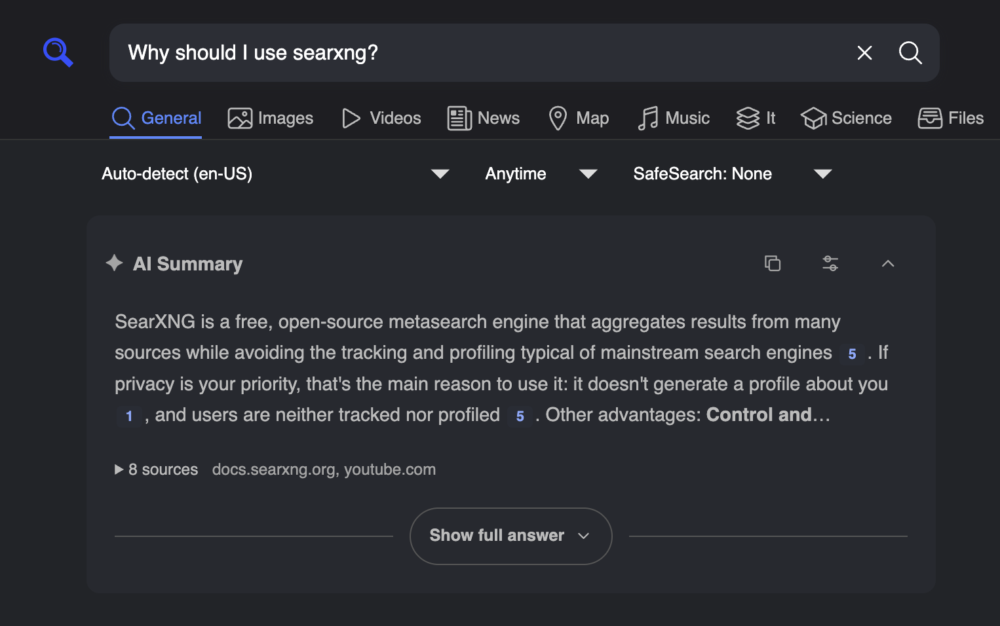

# AI overviews for SearXNG

Add streaming, source-linked answers above SearXNG search results. End a search
with `?` to generate a summary from the returned snippets, using a local model
or a hosted provider.



- Numbered citations open the source snippets used for the answer.
- Markdown answers include copyable code blocks with syntax highlighting.
- Stop, retry, regenerate, and optionally switch between configured models.
- Fits SearXNG's Simple theme, including dark mode and mobile layouts.

**Early-stage software for personal instances.** Tested with SearXNG
`2026.9.19-e831fc2a1` and the Simple theme; other versions and themes are
unverified.

[Provider configuration](docs/providers.md) ·
[Development and testing](docs/development.md) ·
[Architecture](docs/ARCHITECTURE.md)

## Install in SearXNG

These steps add the plugin to an existing Docker Compose deployment that uses the
Simple theme. Clone this repository on the host first; nothing else needs
installing there.

```sh
git clone https://github.com/jacobabahn/ai-overview-searxng.git
```

### 1. Mount the plugin and choose a model

Merge this into your SearXNG service, replacing the host path and model name:

```yaml
services:
  searxng:
    extra_hosts:
      - "host.docker.internal:host-gateway"
    environment:
      AI_OVERVIEW_BACKEND: ollama
      AI_OVERVIEW_MODEL: your-installed-model # exact name from `ollama list`
      AI_OVERVIEW_ENDPOINT: http://host.docker.internal:11434/api/chat
    volumes:
      - /absolute/path/ai-overview-searxng/src/ai_overview:/usr/local/searxng/ai_overview:ro
```

This uses Ollama running on the Docker host. The model server must listen on an
address the container can reach; `localhost` inside the container is the
container itself.

To use something else:

- **Hosted provider:** set `AI_OVERVIEW_BACKEND` to `openai`, `gemini`,
  `openrouter`, or `opencode_go`, remove `AI_OVERVIEW_ENDPOINT`, and add
  `AI_OVERVIEW_API_KEY`. The key stays on the server.
- **OpenAI-compatible local server:** set the backend to `local` and the endpoint
  to its full `/v1/chat/completions` URL.
- **Several models, a model picker, or tuned limits:** mount an `overview.yml`
  instead of setting these variables.

[Provider configuration](docs/providers.md) covers every variable and the YAML
format. There is no automatic fallback to another provider.

### 2. Enable the plugin

Merge these entries into your SearXNG `settings.yml`, preserving any existing
plugins and outgoing settings:

```yaml
plugins:
  ai_overview.plugin.SXNGPlugin:
    active: true
outgoing:
  networks:
    ai_overview:
      enable_http: true
      retries: 0
```

`enable_http` lets the plugin reach local HTTP model endpoints; set it to `false`
if every endpoint uses HTTPS. `server.secret_key` must be a strong random value
of at least 24 characters. Disable any other AI-answer plugin to avoid duplicate
panels.

### 3. Restart and search

```sh
docker compose up -d --force-recreate searxng
```

Search for `why is the sky blue?`. If no summary appears, enable **AI overview**
in Preferences, since saved browser preferences can override the default, then
see [Troubleshooting](#troubleshooting). Restart SearXNG after any configuration
change.

[compose.env.example.yml](compose.env.example.yml) and
[compose.example.yml](compose.example.yml) are complete reference deployments for
the environment and YAML setups. Pin your SearXNG image version or digest.

### Without Docker

Install this repository into SearXNG's Python environment with
`pip install /path/to/ai-overview-searxng`, set the same environment variables
for the SearXNG process, and apply step 2.

## Try it without SearXNG or a model

To see the interface before installing anything into SearXNG, run the standalone
demo from the repository root. It requires Python 3.11+,
[uv](https://docs.astral.sh/uv/), and Make:

```sh
uv sync --locked
make demo
```

Open <http://127.0.0.1:8765>. The demo uses prerecorded fixture answers; it needs
no SearXNG instance, API key, or model server.

## Privacy and limitations

The selected provider receives your question and the search snippets chosen as
sources. Hosted providers receive that data even when SearXNG itself is
self-hosted; local models keep generation on the configured server.
Search-engine requests still follow your SearXNG settings.

- A summary is generated only for first-page, General-category searches that end
  in `?`.
- Answers are written from search snippets, not full pages. A citation shows
  which source the model was given; it does not prove the claim is correct.
- Completed answers are cached in server memory for 30 minutes per browser, so
  reloading or repeating a search does not pay for a new generation. Regenerate
  always asks the model again.
- The browser's local storage holds only the selected model and a random ID that
  scopes the cache to that browser.
- Each worker runs at most 2 generations at once. There are no per-user rate or
  spending limits, so a public instance can run up provider costs.
- Compatibility is tested against recorded provider responses, not live against
  every backend and model.

[Architecture](docs/ARCHITECTURE.md) describes state handling, budgets, and the
follow-up API, which the current interface does not expose.

## Troubleshooting

| Symptom | Check |
| --- | --- |
| No summary panel | Simple theme, plugin enabled in Preferences, first page of General results, and a trailing `?`. Check SearXNG logs for configuration errors. |
| Configuration error | YAML paths and permissions, a valid `default_profile`, and a strong `server.secret_key`. Restart after edits. |
| Local model unreachable | Test the endpoint from inside the container. Enable HTTP on the `ai_overview` network for HTTP endpoints. |
| Answer arrives all at once | Disable reverse-proxy buffering for `/ai-overview/stream` and set its read timeout longer than the configured generation timeout. |
| Summary stays busy | The worker has reached its generation limit. Automatic retries are bounded; wait for active requests to finish or use Retry. |

## Development

See [development and testing](docs/development.md) for local checks, real SearXNG
integration tests, and packaging. Bug reports should include the SearXNG version,
backend, model ID, and reproduction steps. Omit credentials and private search
content.

## License

[MIT](LICENSE). Bundled [Marked](src/ai_overview/static/marked.LICENSE.txt) and
[Highlight.js](src/ai_overview/static/highlight.LICENSE.txt) retain their own
license notices.
