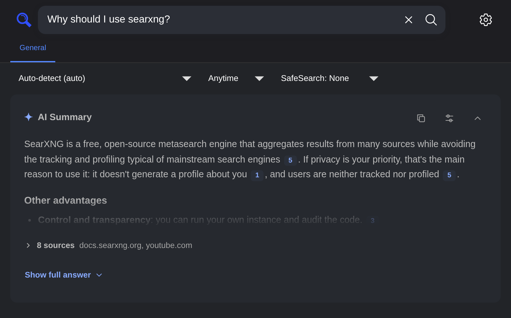

# AI overviews for SearXNG

End a search with `?` and a cited answer streams in above the SearXNG results,
written from the returned snippets by a local model or a hosted provider.



- Numbered citations open the source snippets the answer was written from.
- Ask follow-up questions; each answer keeps its own sources. Stop, retry, or
  regenerate at any point.
- Markdown answers include copyable code blocks with syntax highlighting.
- Optional: a model picker, a choice of how much the model thinks, and a chat
  mode that turns the results page into a full-width conversation with suggested
  next questions (end a search with `??` to open straight into it).

**Early-stage software for personal instances.** Tested with SearXNG
`2026.9.19-e831fc2a1` and the Simple theme, including dark mode and mobile
layouts; other versions and themes are unverified. Providers are tested against
recorded responses, not live against every backend and model.

## Install

These steps add the plugin to an existing Docker Compose deployment. Clone this
repository on the host first; nothing else needs installing there.

```sh
git clone https://github.com/jacobabahn/ai-overview-searxng.git
```

### 1. Mount the plugin and choose a model

Merge this into your SearXNG service, replacing the host path and model name:

```yaml
services:
  searxng:
    extra_hosts:
      - "host.docker.internal:host-gateway"
    environment:
      AI_OVERVIEW_BACKEND: ollama
      AI_OVERVIEW_MODEL: your-installed-model # exact name from `ollama list`
      AI_OVERVIEW_ENDPOINT: http://host.docker.internal:11434/api/chat
    volumes:
      - /absolute/path/ai-overview-searxng/src/ai_overview:/usr/local/searxng/ai_overview:ro
```

This uses Ollama running on the Docker host. The model server must listen on an
address the container can reach; `localhost` inside the container is the
container itself.

To use something else:

- **Hosted provider:** set `AI_OVERVIEW_BACKEND` to `openai`, `gemini`,
  `openrouter`, or `opencode_go`, remove `AI_OVERVIEW_ENDPOINT`, and add
  `AI_OVERVIEW_API_KEY`. The key stays on the server.
- **OpenAI-compatible local server:** set the backend to `local` and the endpoint
  to its full `/v1/chat/completions` URL.
- **Several models, the model picker, chat mode, thinking control, or tuned
  limits:** mount an `overview.yml` instead of setting these variables.

[Configuration](docs/providers.md) lists every variable and YAML setting.

### 2. Enable the plugin

Merge these entries into your SearXNG `settings.yml`, preserving any existing
plugins and outgoing settings:

```yaml
plugins:
  ai_overview.plugin.SXNGPlugin:
    active: true
outgoing:
  networks:
    ai_overview:
      enable_http: true
      retries: 0
```

- `enable_http` lets the plugin reach model endpoints over plain HTTP. Set it to
  `false` if every endpoint uses HTTPS.
- `server.secret_key` must be a strong random value of at least 24 characters;
  the plugin signs conversation state with it and will not load without one.
- Disable any other AI-answer plugin to avoid duplicate panels.

### 3. Restart and search

```sh
docker compose up -d --force-recreate searxng
```

Search for `why is the sky blue?`. If no summary appears, enable **AI overview**
in Preferences, since saved browser preferences can override the default, then
see [Troubleshooting](#troubleshooting). Restart SearXNG after any configuration
change.

[compose.env.example.yml](compose.env.example.yml) and
[compose.example.yml](compose.example.yml) are complete reference deployments for
the environment and YAML setups. Pin your SearXNG image version or digest.

### Without Docker

Install this repository into SearXNG's Python environment with
`pip install /path/to/ai-overview-searxng`, set the same environment variables
for the SearXNG process, and apply step 2.

## Try it without SearXNG or a model

The standalone demo shows the interface with prerecorded answers. From the
repository root, with Python 3.11+, [uv](https://docs.astral.sh/uv/), and Make:

```sh
uv sync --locked
make demo
```

Open <http://127.0.0.1:8765>.

## Privacy and limits

- Only first-page, General-category searches ending in `?` reach the model. It
  receives the question and the search snippets chosen as sources. A hosted
  provider receives them even when SearXNG is self-hosted; a local model keeps
  them on the configured server. Search-engine requests still follow your
  SearXNG settings.
- Answers are written from search snippets, not full pages. A citation shows
  which source the model was given; it does not prove the claim is correct.
- There are no per-user rate or spending limits, only a per-worker cap on
  simultaneous generations, so a public instance can run up provider costs.
- Completed first answers are kept in server memory, by default for 30 minutes
  per browser, so repeating a search does not pay for a new generation.

[Configuration](docs/providers.md#settings-reference) has the settings behind
these limits, and [Architecture](docs/ARCHITECTURE.md) describes signed state,
the answer cache, and how follow-ups are searched.

## Troubleshooting

| Symptom | Check |
| --- | --- |
| No summary panel | Simple theme, plugin enabled in Preferences, first page of General results, and a trailing `?`. Otherwise look in the SearXNG log for a configuration error. |
| Configuration error | The SearXNG log line `AI overview configuration failed: …` names the problem. Check YAML paths and permissions, a valid `default_profile`, and a strong `server.secret_key`. Restart after edits. |
| "The selected provider needs an API key." | The log warns at startup about each profile whose key variable is unset or empty. Pass the variable into the SearXNG container, or point `api_key_env` at the one you set. |
| Local model unreachable | Test the endpoint from inside the container. Enable HTTP on the `ai_overview` network for HTTP endpoints. |
| Answer arrives all at once | Disable reverse-proxy buffering for `/ai-overview/stream` and set its read timeout longer than the configured generation timeout. |
| Summary stays busy | The worker has reached its generation limit. Automatic retries are bounded; wait for active requests to finish or use Retry. |

## Development

[Development and testing](docs/development.md) covers local checks, the SearXNG
integration tests, packaging, and what to include in a bug report.

## License

[MIT](LICENSE). Bundled [Marked](src/ai_overview/static/marked.LICENSE.txt) and
[Highlight.js](src/ai_overview/static/highlight.LICENSE.txt) retain their own
license notices.
